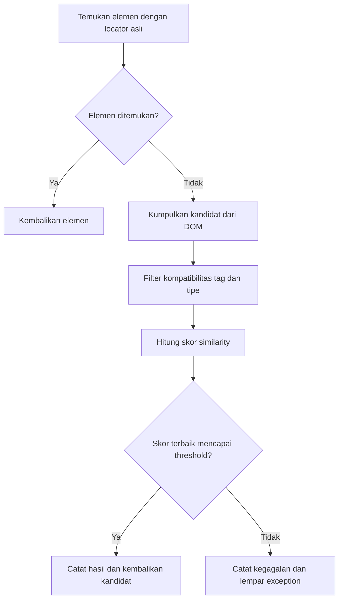

# Self-Healing Selenium

Prototipe penelitian skripsi untuk memulihkan pencarian elemen Selenium ketika locator lama tidak lagi cocok dengan DOM. Sistem mencari kandidat elemen pengganti, menyaring kompatibilitasnya, lalu memilih kandidat berdasarkan skor kemiripan teks, locator, dan posisi.

Proyek ini mencakup engine Java, pengujian baseline dan self-healing dengan JUnit, GUI Java Swing, serta data dan skrip analisis eksperimen. Engine utama menggunakan aturan dan perhitungan similarity; eksperimen machine learning tersedia terpisah di `train_ai.py` dan belum terintegrasi ke pemilihan elemen saat Selenium berjalan.

## Cara kerja



- **Smart text similarity:** menggabungkan Levenshtein, pencocokan substring, dan cakupan token.
- **Semantic guarding:** menyaring kandidat berdasarkan kompatibilitas elemen untuk mengurangi pemilihan elemen dengan fungsi yang berbeda.
- **Dua cara integrasi:** `HealingDriver` menerima profil target secara eksplisit; `AutoHealingWebDriver` membungkus driver dan menurunkan profil dari locator yang gagal.
- **Log untuk evaluasi:** hasil healing dan kandidat dicatat ke CSV, termasuk skor komponen, ID percobaan, SUT (*system under test*), status kandidat, dan penanda evaluasi jika tersedia.

Konfigurasi produksi di `SimilarityEngine`:

| Komponen | Bobot |
| --- | ---: |
| Teks | 0,50 |
| Locator | 0,30 |
| Posisi | 0,20 |
| Threshold default | 0,50 |

Jika posisi terakhir target tidak tersedia, bobot teks dan locator dinormalisasi:

```text
score = (0.50 / 0.80) * text_score + (0.30 / 0.80) * locator_score
```

Kandidat dengan skor tertinggi diterima jika skornya mencapai threshold. Elemen yang diterima tetap perlu diverifikasi melalui assertion: skor tinggi belum menjamin bahwa kandidat adalah target yang benar. Healing mengembalikan elemen pengganti saat eksekusi; implementasi ini tidak menulis ulang locator dalam berkas test.

## Teknologi dan kebutuhan

| Komponen | Versi / kebutuhan |
| --- | --- |
| Java | JDK 21 |
| Build | Apache Maven 3.x |
| Selenium Java | 4.18.1 |
| JUnit Jupiter | 5.10.2 |
| WebDriverManager | 5.7.0 |
| Browser | Google Chrome dan driver yang kompatibel |
| Analisis offline | Python 3.10+ untuk `reviewer_analysis.py` |
| Eksperimen AI opsional | `pandas`, `numpy`, `scikit-learn` |

`BaseTest` menggunakan Selenium Manager melalui `ChromeDriver`; sejumlah suite SUT mandiri menggunakan WebDriverManager. Koneksi internet dibutuhkan untuk dependensi, penyediaan driver, dan pengujian situs publik.

## Menyiapkan proyek

```powershell
git clone https://github.com/fulviandafa/self-healing-testing-selenium.git
cd self-healing-testing-selenium
git switch experiment/ai-comparison
java -version
mvn -version
mvn -B -DskipTests test
```

Perintah terakhir mengompilasi kode utama dan kode test tanpa menjalankan browser. Untuk memeriksa hasil kompilasi dari awal, gunakan `mvn clean -DskipTests test`.

## Menjalankan pengujian

Jalankan perintah dari direktori yang berisi `pom.xml`. Konfigurasi Surefire default hanya memilih `TestAnugrahJayaBaseline` dan `TestAnugrahJayaHealing`; `mvn test` tidak otomatis menjalankan seluruh SUT.

### SUT lokal ANUGRAH_JAYA

Aplikasi ANUGRAH_JAYA disiapkan secara terpisah dan harus dapat diakses sebelum test dijalankan. URL default adalah `http://anugrah_jaya.test/app/index.html`. Suite menggunakan beberapa halaman aplikasi, termasuk halaman produk, transaksi, utang, dashboard, dan cetak daftar barang. Mengganti URL saja tidak membuat suite cocok untuk aplikasi dengan DOM yang berbeda.

```powershell
# Baseline Selenium
mvn test "-Dtest=TestAnugrahJayaBaseline" "-DbaseUrl=http://anugrah_jaya.test/app/index.html"

# Suite dengan profil target eksplisit
mvn test "-Dtest=TestAnugrahJayaHealing" "-DbaseUrl=http://anugrah_jaya.test/app/index.html"

# Baseline dengan wrapper auto-healing
mvn test "-Dtest=TestAnugrahJayaBaseline" "-DselfHealing.enabled=true" "-Dhealing.threshold=0.50"
```

Mode baseline dapat menghasilkan kegagalan yang memang dirancang untuk menunjukkan locator yang rusak. Periksa assertion dan laporan test sebelum menyimpulkan keberhasilan eksperimen.

### Memilih SUT publik

```powershell
mvn test "-Dtest=TestSauceDemoBaseline"
mvn test "-Dtest=TestSauceDemoHealing" "-Dstep.delay.ms=500"
mvn test "-Dtest=TestBingHealing"
```

Daftar suite tersedia di [`src/test/java/com/fulvian/tests`](src/test/java/com/fulvian/tests). Suite situs publik memiliki konfigurasi dan prasyarat masing-masing. Beberapa test membersihkan log SUT pada awal eksekusi; simpan salinan dataset sebelum menjalankan ulang eksperimen yang ingin dipertahankan.

### Properti yang tersedia

| Properti | Default | Cakupan |
| --- | --- | --- |
| `baseUrl` | `http://anugrah_jaya.test/app/index.html` | Suite yang memakai `BaseTest` |
| `headless` | `false` | Chrome di `BaseTest` |
| `selfHealing.enabled` | `false` | Wrapper auto-healing di `BaseTest` |
| `healing.threshold` | `0.50` | Wrapper auto-healing di `BaseTest` |
| `healing.log.file` | `results/healing_log.csv` | Lokasi log healing; dapat diatur ulang oleh suite |
| `healing.candidateLog.file` | Diturunkan dari lokasi log healing | Lokasi log kandidat |
| `step.delay.ms` | Bergantung suite | Jeda langkah pada suite yang mendukungnya |

Suite yang membuat `HealingDriver` sendiri dapat menetapkan threshold langsung di kode. Properti `headless` dan `healing.threshold` belum menjadi konfigurasi global untuk semua suite.

## Menggunakan engine dalam test

Contoh berikut dijalankan setelah `driver` dibuat dan halaman SUT dibuka:

```java
import com.fulvian.healing.ElementProfile;
import com.fulvian.healing.HealingDriver;
import org.openqa.selenium.By;
import org.openqa.selenium.WebElement;

ElementProfile profile = new ElementProfile(
        "+ Tambah Produk", "inputProductBtn", "id");
HealingDriver healing = new HealingDriver(driver, "SH-001", "id_change", 0.50);
WebElement button = healing.findElement(By.id("inputProductBtn"), profile);
button.click();
```

Untuk integrasi melalui wrapper:

```java
import com.fulvian.healing.AutoHealingWebDriver;
import org.openqa.selenium.WebDriver;
import org.openqa.selenium.chrome.ChromeDriver;

WebDriver driver = new AutoHealingWebDriver(new ChromeDriver(), true, 0.50);
```

Wrapper menangani kegagalan `findElement(By)` pada driver. `findElements(By)` diteruskan ke driver asli; pencarian melalui `WebElement` tidak dibungkus otomatis.

## GUI

Jalankan kelas `com.fulvian.gui.SelfHealingGui` dari IDE dengan dependensi Maven, atau gunakan PowerShell:

```powershell
mvn compile dependency:build-classpath "-Dmdep.outputFile=target/classpath.txt"
$guiClasspath = "target/classes;" + (Get-Content -Raw target/classpath.txt).Trim()
java -cp $guiClasspath com.fulvian.gui.SelfHealingGui
```

GUI menyediakan pemilihan direktori proyek dan script, pengaturan eksekusi dan threshold, output console, serta tabel hasil CSV. Maven harus tersedia pada `PATH` karena GUI menjalankan test melalui proses Maven.

## Dataset dan analisis

Data aktif ada di [`results/`](results), sedangkan snapshot sebelum rerun reviewer disimpan di [`archive/pre_reviewer_rerun_20261002/`](archive/pre_reviewer_rerun_20261002/README.md).

| Artefak | Isi |
| --- | --- |
| `results/*_healing_log.csv` | Hasil percobaan healing per SUT |
| `results/*_candidates_log.csv` | Kandidat, skor, filter, dan pilihan per percobaan |
| `results/reviewer_run_summary.csv` | Ringkasan eksekusi 23 SUT |
| `results/final_dataset_summary.csv` | Ringkasan dataset dan metrik per SUT |
| `results/candidate_sensitivity_results.csv` | Dataset kandidat untuk analisis sensitivitas |
| `results/weight_sensitivity_results.csv` | Simulasi variasi bobot |
| `results/threshold_sensitivity_results.csv` | Simulasi variasi threshold |
| `results/reviewer-analysis-report.md` | Audit skor, evaluasi, dan keterbatasan |

Analisis offline menggunakan pustaka standar Python dan menulis ulang keluaran agregat dari CSV per SUT yang tersedia:

```powershell
python reviewer_analysis.py
```

Untuk mengulang pengujian browser pada 23 SUT lalu membuat laporan:

```powershell
.\run_reviewer_analysis.ps1
```

Runner tersebut membersihkan log healing dan kandidat yang dipilih, menjalankan suite secara berurutan, lalu memanggil analisis. Jalankan setelah membuat snapshot jika data aktif masih dibutuhkan. `sensitivity_analysis.py` adalah analisis tambahan berbasis baris log healing; analisis kandidat pada `reviewer_analysis.py` digunakan untuk laporan reviewer.

Eksperimen Logistic Regression di `train_ai.py` membutuhkan dependensi tambahan:

```powershell
python -m pip install pandas numpy scikit-learn
python train_ai.py
```

Skrip AI memakai `results/candidates_log.csv` dan pemetaan label khusus skenario ANUGRAH_JAYA. Dataset harus memiliki label target yang valid; skrip ini bukan trainer umum untuk seluruh CSV multi-SUT.

### Hasil yang tersimpan

Menurut [laporan rerun tanggal 2 Oktober 2026](results/reviewer-analysis-report.md), 23 SUT mencakup 129 skenario, dengan 88 percobaan yang mencapai proses healing:

| Metrik | Nilai |
| --- | ---: |
| Healing diterima | 81 dari 88 |
| Healing gagal | 7 dari 88 |
| Healing Success Rate (HSR) | 92,05% |
| Healing diterima yang memiliki label objektif | 74 |
| False positive pada hasil berlabel | 8 |
| FPR pada hasil diterima yang berlabel | 10,81% (8/74) |

HSR mengukur penerimaan kandidat di atas threshold, bukan ketepatan target. Laporan juga mencantumkan FPR historis-kompatibel 9,88% (8/81), yang memasukkan 7 hasil diterima tanpa label objektif ke penyebut. Skenario yang terhalang sebelum healing dilaporkan terpisah. Angka ini adalah hasil eksperimen tersimpan, bukan hasil pengujian ulang saat README dibuat.

Seluruh 88 percobaan pada rerun tersebut tidak memiliki posisi terakhir target, sehingga skor memakai normalisasi teks dan locator. Perubahan DOM situs publik, CAPTCHA, akses jaringan, dan ketersediaan aplikasi lokal dapat memengaruhi replikasi. Penanda ground truth dipakai untuk evaluasi offline dan tidak digunakan untuk menentukan kandidat terbaik.

## Struktur proyek

```text
src/main/java/com/fulvian/
  healing/          Engine, profil target, wrapper, dan logger CSV
  gui/              Antarmuka Java Swing
src/test/java/com/fulvian/
  base/             Setup driver untuk suite ANUGRAH_JAYA
  tests/            Suite baseline dan healing berbagai SUT
  utils/            Helper wait, mutasi DOM, data, dan screenshot
docs/               Desain eksperimen dan panduan skenario
results/            Dataset, ringkasan, dan laporan eksperimen
archive/            Snapshot hasil eksperimen sebelumnya
reviewer_analysis.py
run_reviewer_analysis.ps1
train_ai.py
pom.xml
```

## Dokumentasi lanjutan

- [Panduan validasi ahli dan penyiapan lingkungan](PANDUAN_VALIDASI.md)
- [Dokumentasi arsitektur sistem](self_healing_system_documentation.md)
- [Desain eksperimen](docs/experimental-design.md)
- [Matriks test case](docs/test-case-matrix.md)
- [Panduan script ANUGRAH_JAYA](docs/anugrah-jaya-test-script-guide.md)

Untuk konfigurasi dan skema CSV terkini, gunakan kode sumber serta laporan reviewer sebagai acuan; sebagian dokumentasi desain menjelaskan tahapan penelitian sebelumnya.
